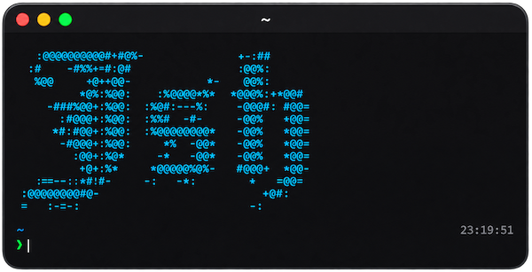
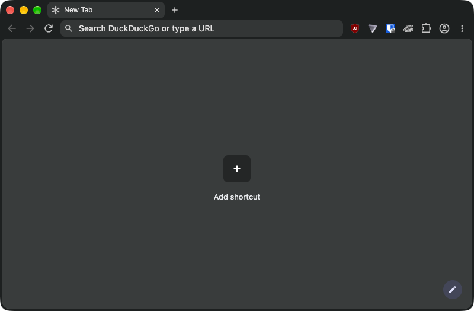
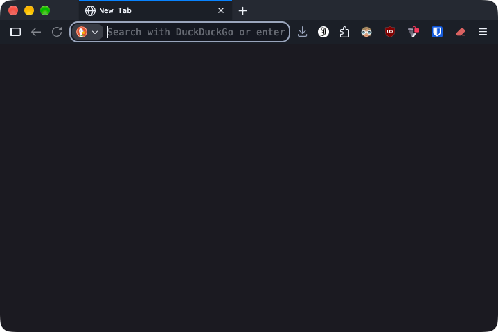

# jsh

<p align="center">
  
</p>

## Overview

This repository began as home to my dotfiles and has evolved into a fully automated toolkit to provide
me a consistent experience across all of my workstations. Although I do not expect others to use it,
I do try to maintain it for the general populace and hope it at least inspires tweaks to their
respective environments.

## Table of contents

- [Installation](#installation)
- [Commands](#commands)
- [Key features](#key-features)
- [Modules](#modules)
- [Module reference](#module-reference)
- [Shell and utilities](#shell-and-utilities)
- [System-specific configuration](#system-specific-configuration)
- [Development](#development)

## Installation

From an interactive terminal, install Git and curl, then run:

```sh
curl -fsSL https://raw.githubusercontent.com/jovalle/jsh/main/j.sh | bash
```

The installer clones into `~/.jsh` and opens the setup wizard. It refuses to replace an
existing checkout. To choose another destination, set `JSH_HOME` in the shell running the
installer. You can also clone manually and run `~/.jsh/j.sh`.

The wizard detects your platform and desktop, offers starting points and a searchable
module picker, and lets you review or preview the plan before applying it. Use the arrow
keys and space to select modules; `/` searches, Enter continues, and Escape goes back.
The preview is a best estimate: some scripts can only describe their changes. Existing
files may be backed up, and browsers may close and reopen when required for changes.
System-level work is deferred to direct `jsh` commands. Install Python 3.9 or later before
running the wizard if it is not already available. A successful setup opens the isolated
jsh shell automatically; exit it to return to your previous shell.

Your choices are saved in `$XDG_STATE_HOME/jsh/selection.json` (normally
`~/.local/state/jsh/selection.json`) after confirmation. Unqualified commands use this
machine's saved selection; explicitly naming modules works independently and includes
those modules' optional steps. Run `~/.jsh/j.sh` again to change the selection. Without a
saved selection, unqualified commands continue to cover all applicable modules.

## Commands

After setup, use `jsh` in the shell that opens. In a new Zsh session, the `shell` module
also makes `jsh` available directly.

| Command                     | Does                                                            |
| --------------------------- | --------------------------------------------------------------- |
| `jsh MODULE COMMAND`        | Run a module command, for example `jsh audio cycle`             |
| `jsh configure [MODULE...]` | Apply settings: OS preferences, desktop, apps                   |
| `jsh install [MODULE...]`   | Install missing software; never upgrades                        |
| `jsh link [MODULE...]`      | Link each module's `home/` files into your home directory       |
| `jsh list`                  | List modules and their commands                                 |
| `jsh setup [MODULE...]`     | `install`, then `link`, then `configure`                        |
| `jsh status [MODULE...]`    | Show checkout state, missing software, and unlinked files       |
| `jsh update [MODULE...]`    | Upgrade declared software that has a newer version              |
| `jsh`                       | Open the isolated jsh Zsh shell (history under `local/runtime`) |

With no module names a command uses the saved selection, or every applicable module if
there is no selection. `--dry-run` reports what would change without changing anything.
A failed step is reported with the end of its log and the log path under `local/logs/`;
later steps still run. Root changes use `sudo -n`, so authorize sudo first (`sudo -v`);
jsh never prompts for a password. Direct commands do not ask for confirmation. Zsh
completes `jsh` commands, module names, and module commands.

## Key features

- **Choose your setup:** the wizard detects your platform and desktop, lets you select
  modules, and previews the plan.
- **Keep it modular:** each module describes its software, linked files, and configuration.
- **Repeat safely:** install adds missing software; update upgrades declared software;
  dry runs show the planned changes.
- **Work in your shell:** an isolated Zsh environment includes a prompt, project navigation,
  completion, and command-line utilities.
- **Manage app settings:** modules cover browsers, editors, terminal settings, and desktop
  behavior alongside system-specific configuration.

### A look at the managed apps

| Helium                               | Waterfox                                 |
| ------------------------------------ | ---------------------------------------- |
|  |  |

## Modules

| Module                                                 | Covers                                                                       |
| ------------------------------------------------------ | ---------------------------------------------------------------------------- |
| `apps`                                                 | Apps without managed settings; extra casks on the `archon` host              |
| `core`                                                 | Bash, curl, Git, Python, Zsh                                                 |
| `desktop`                                              | GNOME/XFCE appearance, panel, screensaver, and GNOME extensions              |
| `dev`, `kube`, `containers`, `ai`                      | Linters, Kubernetes, container, and AI CLIs, plus graphify and REA skills    |
| `dock`, `keybindings`, `wallpaper`, `audio`, `display` | Desktop behavior and shortcuts                                               |
| `fonts`                                                | JetBrains Mono Nerd Font                                                     |
| `git`                                                  | `.gitconfig`                                                                 |
| `helium`, `waterfox`, `vscode`, `sublime`, `ghostty`   | The app plus its managed settings                                            |
| `linux`                                                | Kernel limits, memory, earlyoom, zram, coredump, sleep, timezone, sudo       |
| `macos`                                                | `defaults` preferences, restarting Dock, Finder, or SystemUIServer           |
| `services`                                             | SSH agent, GPG agent, and Podman user services                               |
| `shell`                                                | `.zshrc` and friends, Zsh plugins in `local/vendor`, fzf, the `jsh` launcher |
| `skills`                                               | Agent skill repos in `local/vendor/skills`, linked into `~/.agents/skills`   |
| `tools`                                                | Everyday CLI tools and their settings (Homebrew on Linux when installed)     |

Notes:

- When Syncthing is running, `jsh configure tools` excludes `.git` and `node_modules` from
  every configured folder and new-folder defaults. It also excludes this checkout's
  `local/` and `tmp/`.
  Syncthing ignore rules are per-device; run it on each machine.
- Linux AppImages need x86_64 or aarch64 and a working FUSE runtime. Ghostty's Linux
  AppImage is a [community build](https://github.com/pkgforge-dev/ghostty-appimage).
- `JSH_TIMEZONE` (default `America/New_York`), `JSH_WALLPAPER` (no default), and
  `JSH_AUDIO_POLICY` adjust the `linux`, `wallpaper`, and `audio` modules.
- Open each browser once to create a profile, then run `jsh configure helium waterfox`.
  Browsers are closed and reopened only when pending profile changes require it; a browser
  that cannot be closed is left for manual attention. Policies are root-owned and replaced
  wholesale; app settings files are merged, keeping unrelated settings.
- Replaced files go to `$XDG_STATE_HOME/jsh/backups` (normally
  `~/.local/state/jsh/backups`); a stale link into this checkout is replaced without
  one. Targets under a symlinked directory are left for you to review.
- Personal shell additions belong in `~/.jshrc`, `~/.local/.jshrc`, or `local/.jshrc`.
  Git identities live in `conf/git.json` (see [conf/git.example.json](conf/git.example.json)).

## Module reference

A module is `modules/NAME/` (one lowercase word) containing:

- `module.json`: the manifest (below).
- `home/`: files linked into `$HOME` at the same relative path, one link per file.
- Scripts and data files that its steps refer to.

A `link` entry links its `from` path (relative to the module) to `to` as one link,
so a directory is linked whole.

```json
{
  "description": "Example app with its settings and a shortcut command",
  "when": { "platform": ["darwin", "linux"] },
  "install": [
    { "brew": { "casks": ["example"] } },
    {
      "appimage": {
        "name": "example",
        "release": "https://api.github.com/repos/example/example/releases/latest"
      }
    }
  ],
  "configure": [{ "script": "configure.py" }],
  "link": [{ "from": "settings.json", "to": "~/.config/example/settings.json" }],
  "commands": { "sync": { "run": "sync.sh", "about": "Sync example data now" } }
}
```

Each `install`, `configure`, or `update` step names one handler and may add
`when` (same keys as the module; optional: `platform`, `desktop`, `host`),
`"root": true` (skip with a notice when sudo is not authorized), or `"optional": true`
(run only when the module is named, as in `jsh install sublime`). `platform` matches
`darwin`, `debian`, `rhel`, or `linux`; `desktop` matches `darwin`, `gnome`, or `xfce`;
`host` matches the short host name. Malformed manifests are rejected with the file and
the problem.

| Handler    | Arguments                              | `install`                            | `update`                      |
| ---------- | -------------------------------------- | ------------------------------------ | ----------------------------- |
| `appimage` | `name`, `release` URL, `architectures` | Into `~/.local/bin`, SHA-256 checked | When the release digest moves |
| `apt`      | package list (Debian family)           | Missing ones, `--no-upgrade`         | Declared, upgradable ones     |
| `brew`     | `taps`, `formulae`, `casks` lists      | Missing ones (casks on macOS only)   | Declared, outdated ones       |
| `dnf`      | package list (RHEL family)             | Missing ones                         | Declared, upgradable ones     |
| `flatpak`  | app ID list (Linux, Flathub, per user) | Missing ones                         | Apps with updates             |
| `git`      | `path: url` pairs under `local/vendor` | Shallow clones                       | Reset to the remote `HEAD`    |
| `script`   | `NAME [ARGS]`, a file in the module    | Runs in whichever phase lists it     | Only from `update:`           |
| `uv`       | `command: package` pairs               | Missing commands                     | `uv tool upgrade`             |

Batched handlers (`brew`, `apt`, `dnf`, `flatpak`, `uv`, `git`) collect every module's
steps into one call per run. Python scripts define `install(ctx)`, `configure(ctx)`,
or `update(ctx)` and report through `ctx.added`, `ctx.changed`, `ctx.current`,
`ctx.notice`, and `ctx.run`; [lib/jsh/](lib/jsh) has shared helpers for settings
files, policies, downloads, and desktop settings. Bash scripts source
`lib/core.sh` and report with `jsh::added`, `jsh::changed`, `jsh::current`, and
`jsh::notice`. A new handler is a file in [lib/jsh/handlers/](lib/jsh/handlers).

## Shell and utilities

`j` is a Zsh function loaded by `.zshrc` for jumping between projects and stacks:

- `j` opens a picker; `j QUERY` jumps to the best match by frecency; `j --help` lists
  the rest.
- Jump targets are the directories under `J_PATHS` (default `$GIT_BASE`) and
  `J_STACKS` (default `~/Stacks`), each stack, and each stack's repositories.
- `projects` summarizes the Git repositories in those places.

Each new interactive shell loads the SSH keys named in `conf/git.json` that the agent
does not hold yet and runs the executables in `local/init.d` (or `JSH_INIT`), printing
only what it added or what failed. Agent shells skip both.

Integrations can show a directory relative to a project root in the prompt by setting
`_JSH_PROMPT_DIR_ROOT` and a prompt-formatted `_JSH_PROMPT_DIR_LABEL` from a `precmd`
hook.

These commands are on `PATH` through `bin/`:

| Command                    | Purpose                                                    |
| -------------------------- | ---------------------------------------------------------- |
| [cafe](bin/cafe)           | Keep the computer awake until interrupted                  |
| [colours](bin/colours)     | Print the terminal's 256-color palette                     |
| [git](bin/git)             | Git plus `save`, `load`, `refresh`, `profile`              |
| [jsh](bin/jsh)             | Open the jsh Zsh shell, or run `jsh COMMAND` from anywhere |
| [jssh](bin/jssh)           | Open an ephemeral jsh Zsh session on a Linux SSH host      |
| [kubecolor](bin/kubecolor) | Colorize interactive `kubectl` output                      |
| [kubectx](bin/kubectx)     | Switch between kubectl contexts                            |
| [kubens](bin/kubens)       | Switch between Kubernetes namespaces                       |
| [nukem](bin/nukem)         | Remove finalizers from a namespace stuck terminating       |
| [proxy](bin/proxy)         | Run a command with proxy environment variables set         |

## System-specific configuration

Modules select steps for macOS, Debian-family or RHEL-family Linux, and supported
desktops. The `macos`, `linux`, and `desktop` modules hold the corresponding
preferences; see the module table and notes above for details.

## Development

```sh
make check   # syntax, headers, readme, modules, lint, and test
make help    # each check on its own
```

Runtime uses only Bash and the Python 3.9+ standard library. Checks also need Zsh,
ShellCheck, Pylint, yamllint, and markdownlint. Tests use temporary home directories
and mocked commands; no check changes the machine.
