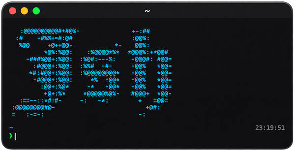

<p align="center">
  
</p>

<p align="center">Life in the shell automated</p>

## Install

```sh
curl -fsSL https://raw.githubusercontent.com/jovalle/jsh/main/install.sh | bash
```

This clones into `~/.jsh` (or `JSH_HOME`), installs Git, Zsh, and the shell plugins, links
`dotfiles/` into your home, and opens the `jsh` shell. From a checkout:

```sh
./install.sh --dry-run  # preview
./install.sh --update   # update core packages and shell plugins
```

Apps, agents, and system settings are configured separately, through the Ansible setup roles:

```sh
make configure                   # every setup role (needs admin rights; otherwise only agentics)
make configure desktop patches   # only the named roles
```

Other commands from a checkout (`make` ships with macOS and Linux):

```sh
jsh update                      # update software and settings
scripts/configure.sh --dry-run  # preview what configuration would change
make list roles                 # list setup roles
```

Homebrew updates include installed dependencies and other outdated packages, and remove
installed packages Homebrew marks deprecated or disabled when nothing depends on them.
On macOS, updates include outdated App Store apps such as Xcode through `mas`, which
needs an Apple Account signed in to the App Store and cached sudo credentials (`sudo -v`).

## Enhancements

### Commands

| Command                         | Enhancement                                                                       |
| ------------------------------- | --------------------------------------------------------------------------------- |
| `git status`                    | Adds identity and branch notes and condenses file lists; `--raw` for plain output |
| `git status -R [DIR]`           | Outside a repository, summarizes every repository below `DIR` (or `~/Projects`)   |
| `git save`, `git load`          | Saves all uncommitted changes, or only `PATH ...`, to a secret gist; loads them   |
| `git refresh`                   | Fetches origin and rebases onto the default branch                                |
| `git create`, `git get`         | Creates or clones a project under `$GIT_BASE`                                     |
| `git profile [NAME]`            | Switches identity, SSH key, and remotes from `local/git.json`                     |
| `git profiles`                  | Lists Git profiles and marks the current identity                                 |
| `git commits`                   | Browses formatted commit history                                                  |
| `git commit`                    | Rejects `Co-authored-by` trailers in every repository, then runs its own hooks    |
| `git handoff`                   | Carries unpushed commits to another workstation through Syncthing                 |
| `j [QUERY]`                     | Jumps to the best frecency match; `j` alone picks a project, `j -c` opens VS Code |
| `projects`                      | Summarizes the Git state of every tracked project and stack                       |
| `ls`, `l`, `la`, `lt`, `tree`   | Uses `eza` with Git status and icons, falling back to `exa` or `ls`               |
| `grep`                          | Colors matches and skips VCS, dependency, cache, and build directories            |
| `kubectl`                       | Colorized through `kubecolor`; `kubectx` and `kubens` switch context/namespace    |
| `nukem`                         | Clears finalizers from a namespace stuck terminating                              |
| `jsh`                           | Opens this checkout's shell without installing anything                           |
| `jsh init [-n] [-y]`            | Sources `local/init/*.zsh` in this shell; `-n` previews, `-y` never prompts       |
| `jsh update [ROLE ...]`         | Runs `install.sh --update` and `scripts/configure.sh --update`, keeping apps open |
| `jssh HOST`                     | Opens SSH with the jsh runtime shipped to a temporary directory on the host       |
| `proxy`                         | Runs a command with HTTP/HTTPS proxy variables set                                |
| `cafe`                          | Keeps the screen awake until stopped                                              |
| `microphone`                    | Mutes the Elgato Wave:3 when it first appears in a desktop session                |
| `colours`                       | Prints the 256-color palette                                                      |
| `awk`, `sed`, `tar` (macOS)     | Use the GNU versions when installed                                               |
| `cp`, `mv`, `rm`, `ln`, `mkdir` | Verbose and interactive; `mkdir` creates parents                                  |

## Layout

```sh
install.sh          # bootstrap: checkout, core packages, shell, links
scripts/configure.sh # setup roles through Ansible (make configure)
Makefile            # shortcuts and checks
ansible/            # site.yml role order, inventory data, role metadata, and shared helpers
scripts/            # bootstrap scripts and smoke checks in check.py
scripts/packages.sh # core bootstrap packages and package-manager maintenance
dotfiles/           # linked into $HOME
lib/                # shell runtime (lib/shell/), bin/git helpers and global Git hooks (lib/git/)
bin/                # everyday commands
```
