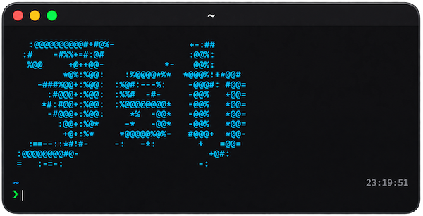
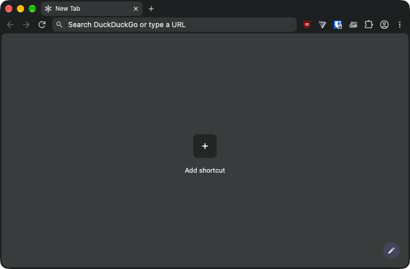
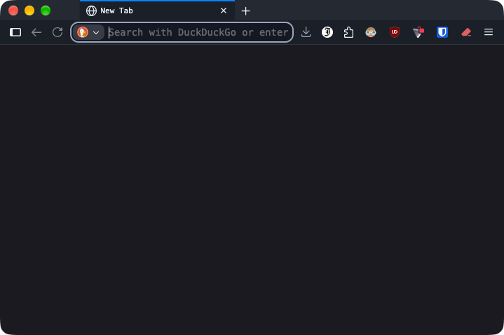

<p align="center">
  
</p>

<p align="center">Life in the shell automated</p>

## Install

```sh
curl -fsSL https://raw.githubusercontent.com/jovalle/jsh/main/install.sh | bash
```

This clones into `~/.jsh` (or `JSH_HOME`), installs Git, Zsh, and the shell plugins, links
`dotfiles/` into your home, and opens the `jsh` shell. From a checkout:

```sh
./install.sh --dry-run        # preview
./install.sh helium waterfox  # also set up named groups
./install.sh --update tools   # update the group and installed Homebrew packages
```

Homebrew updates include installed dependencies and other outdated packages, and remove
installed packages Homebrew marks deprecated or disabled when nothing depends on them.
On macOS, updates include outdated App Store apps such as Xcode through `mas`, which
needs an Apple Account signed in to the App Store and cached sudo credentials (`sudo -v`).

## Enhancements

### Commands

| Command                         | Enhancement                                                                       |
| ------------------------------- | --------------------------------------------------------------------------------- |
| `git status`                    | Adds identity and branch notes and condenses file lists; `--raw` for plain output |
| `git status -R [DIR]`           | Outside a repository, summarizes every repository below `DIR` (or `~/Projects`)   |
| `git save`, `git load`          | Backs up and restores uncommitted changes through a secret gist                   |
| `git refresh`                   | Fetches origin and rebases onto the default branch                                |
| `git create`, `git get`         | Creates or clones a project under `$GIT_BASE`                                     |
| `git profile [NAME]`            | Switches identity, SSH key, and remotes from `local/git.json`                     |
| `git profiles`                  | Lists Git profiles and marks the current identity                                 |
| `git commits`                   | Browses formatted commit history                                                  |
| `git handoff`                   | Carries unpushed commits to another workstation through Syncthing                 |
| `j [QUERY]`                     | Jumps to the best frecency match; `j` alone picks a project, `j -c` opens VS Code |
| `projects`                      | Summarizes the Git state of every tracked project and stack                       |
| `ls`, `l`, `la`, `lt`, `tree`   | Uses `eza` with Git status and icons, falling back to `exa` or `ls`               |
| `grep`                          | Colors matches and skips VCS, dependency, cache, and build directories            |
| `kubectl`                       | Colorized through `kubecolor`; `kubectx` and `kubens` switch context/namespace    |
| `nukem`                         | Clears finalizers from a namespace stuck terminating                              |
| `jsh`                           | Opens this checkout's shell without installing anything                           |
| `jsh init [-n] [-y]`            | Sources `local/init/*.zsh` in this shell; `-n` previews, `-y` never prompts       |
| `jsh update [GROUP ...]`        | Runs `install.sh --update` without closing open apps, then lists apps to restart  |
| `jssh HOST`                     | Opens SSH with the jsh runtime shipped to a temporary directory on the host       |
| `proxy`                         | Runs a command with HTTP/HTTPS proxy variables set                                |
| `cafe`                          | Keeps the screen awake until stopped                                              |
| `microphone`                    | Mutes the Elgato Wave:3 when it first appears in a desktop session                |
| `colours`                       | Prints the 256-color palette                                                      |
| `awk`, `sed`, `tar` (macOS)     | Use the GNU versions when installed                                               |
| `cp`, `mv`, `rm`, `ln`, `mkdir` | Verbose and interactive; `mkdir` creates parents                                  |

### Apps

| Helium                               | Waterfox                                 |
| ------------------------------------ | ---------------------------------------- |
|  |  |

Browser policies, preferences, and extensions are managed alongside VS Code, Sublime Text,
and Ghostty settings. Open each browser once before configuring it.
[Wox](https://github.com/Wox-launcher/Wox) starts at login and takes Command+Space from
Spotlight on macOS and Super+Space from the desktop on Linux; open it once before configuring it.
Helium enables experimental web-platform features on Linux and macOS so [Kingpin](https://github.com/jovalle/kingpin) can use Web Bluetooth where needed. This also enables other experimental web features; existing browser flags are preserved.

## Layout

```sh
install.sh   # bootstrap
scripts/     # setup groups, shared code in scripts/lib/, smoke checks in check.py
dotfiles/    # linked into $HOME
lib/         # shell runtime (lib/shell/) and bin/git helpers (lib/git/)
bin/         # everyday commands
```

`make check` runs syntax checks, ShellCheck, and the shell smoke checks in temporary homes.

Install the commit checks with `pre-commit install` after installing `pre-commit` and Go.
Gitleaks scans staged changes, including `archive/`. If it reports a credential, remove it
from the staged changes and rotate it if it was exposed. `make hooks` runs the checks manually;
Gitleaks still scans only staged changes.

The Secrets CI check scans incoming Git history, including merged commits, using the
Gitleaks version pinned in `.pre-commit-config.yaml`. Local hooks can be bypassed;
configure GitHub push protection and require the CI check on the default branch.
Renovate proposes dependency updates and automerges passing non-major updates.
